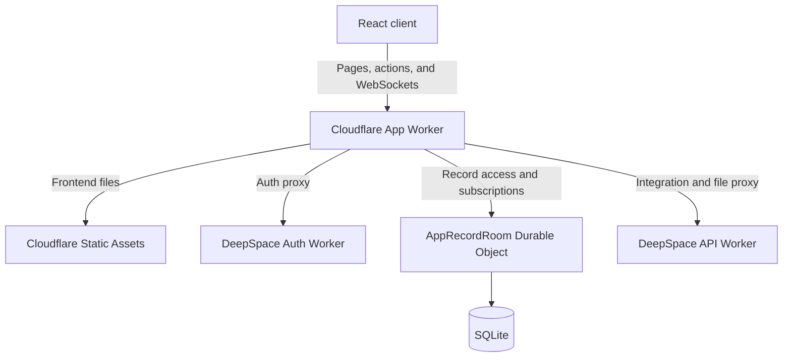
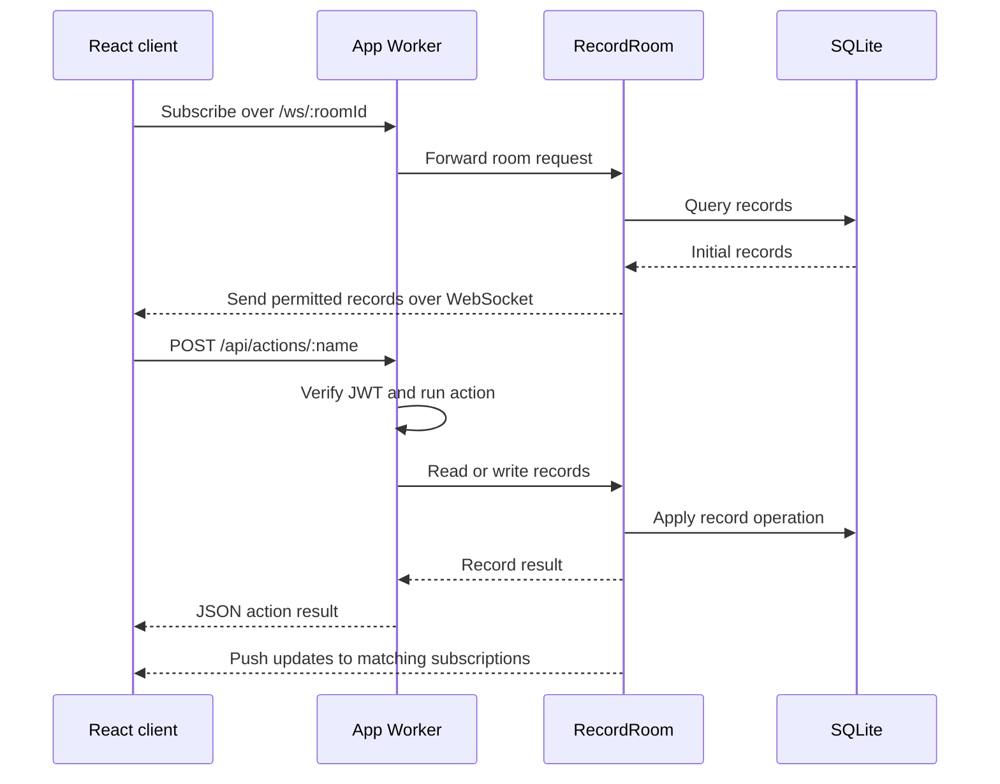

# OpenSpot

OpenSpot is a real-time teammate finder for the fictional **Hack the Lake** hackathon. Participants publish profiles, find builders by skill and availability, form teams, and coordinate in private team chat.

## Run locally

```sh
npm install
npx deepspace auth login
npx deepspace dev start
```

Open http://localhost:5173. The CLI sign-in sets up local development. Use the app's sign-in flow to test a participant session.

```sh
npm run type-check
npm run lint
npm run test:unit
npm run build
```

To deploy, commit the changes you want to ship and run `npx deepspace deploy`. Open the URL printed by the CLI.

## Demo with two accounts

1. Sign in as participant A and save a profile. Use a separate browser session to sign in as B and save another profile.
2. As A, create a team with capacity 2–6, select a track, and list the skills you need.
3. Invite B from Discover. In B’s **Invites** tab, accept the invitation.
4. Confirm A’s **My Team** roster updates without a refresh. Send a message and confirm it appears in both sessions.
5. As A, remove B. Confirm the roster updates and B can no longer access the team chat.

## Architecture



React Router renders the public landing page and the signed-in application. The Cloudflare App Worker handles HTTP, auth proxying, server actions, and WebSocket routing. `AppRecordRoom` extends DeepSpace’s `RecordRoom` and handles record storage, queries, permissions, and realtime subscriptions.

| Route | Behavior |
| --- | --- |
| `/` | Public landing page |
| `/home` | Redirects to `/dashboard` |
| `/dashboard` | Protected dashboard for profiles, discovery, teams, invites, and chat |
| `/settings` | Protected settings |
| `/api-status` | Protected API status page |
| Unmatched path | 404 page |

### Startup and authentication

The shared app layout mounts `DeepSpaceAuthProvider`. `AuthBoot` shows a loading state while authentication resolves, then mounts `RecordProvider`, `RecordScope`, navigation, and the route outlet. `AuthGate` guards the protected routes. Signed-out visitors see `AuthOverlay`, and the dashboard mounts after sign-in.

The App Worker proxies requests under `/api/auth/*` to DeepSpace Auth. Social sign-in starts at `GET /api/auth/social-redirect`. The browser returns to `GET /api/auth/oauth-complete`, where the Worker exchanges the authorization code, sets an HttpOnly session cookie, and redirects back into the app. Sign-out uses `/api/auth/sign-out`.

### Realtime reads and server actions



The main room is scoped as `app:<DEEPSPACE_APP_ID>`. The dashboard calls `useAuthProfileReady` and uses `useQuery` to load profiles, teams, active memberships, and visible invites. Discover combines these records to show candidates. My Team uses profiles and memberships for the roster and subscribes to the current team’s chat messages. The Invites tab shows incoming and outgoing requests.

The UI calls `callAction(name, params)` from `src/lib/actions.ts`. The action endpoint uses the verified JWT to determine the caller’s `userId`. Handlers in `src/actions/index.ts` validate the input and use DeepSpace’s privileged record tools for cross-record operations.

| Action | Behavior |
| --- | --- |
| `saveProfile` | Validates skills and availability, then creates or updates the caller’s profile. |
| `createTeam` | Validates team details and capacity, checks for an active membership, then creates the team and adds its captain in slot 0. |
| `sendInvite` | Checks captain ownership, recipient eligibility, and existing reservations, then creates a pending invite for an open slot. |
| `respondToInvite` | Checks that the caller is the recipient of a pending invite. Acceptance checks capacity and slot availability, creates a membership, and marks the invite accepted. Declining updates the invite status. |
| `removeTeamMember` | Checks captain ownership and the target’s active membership, cancels applicable pending invites, and removes the member from the roster. |
| `sendMessage` | Checks the message length and active membership, then saves the message with the verified sender and a timestamp. |

## Data and permissions

| Collection | Contents and access |
| --- | --- |
| `profiles` | One discovery profile per user, keyed by `userId`. Skills and availability are stored as JSON strings. |
| `teams` | Team name, project idea, track, needed skills, capacity, and captain. |
| `team_members` | Team ID, user ID, slot, and status. `uniqueOn: ['userId']` enforces one membership per user. |
| `invites` | Team, captain, recipient, participants, slot, status, and timestamp. `collaboratorsField` and `read: 'shared'` restrict reads to the captain and recipient. |
| `team_messages` | Team ID, sender, text, and timestamp. `teamField: 'teamId'` and `read: 'team'` restrict reads to team members. The send action checks active membership before writing. |

`AuthGate` controls access to protected screens. The Worker verifies bearer JWTs for server actions, and RecordRoom enforces collection permissions on ordinary record access. Because action tools bypass collection permissions, the handlers explicitly check ownership, invite recipients, and team membership.

### Capacity and partial writes

Pending invites reserve slots before acceptance. The invite constraint `uniqueOn: ['teamId', 'slot', 'status']` permits only one pending reservation per team slot. The same constraint also covers historical statuses. If an older invite with the same team, slot, and target status is retained, a later status update can collide when that slot is reused.

In DeepSpace 0.44.2, the action tools used here expose individual writes. Accepting an invite creates the membership before updating the invite status. If the status write fails, the membership can already exist and the invite can still show as pending. The action reports that partial result.

## Project files

| File | Responsibility |
| --- | --- |
| [worker.ts](worker.ts) | Worker entry point and Durable Object exports |
| [src/server/http-routes.ts](src/server/http-routes.ts) | Static assets, frontend route fallback, and 404 handling |
| [src/server/action-routes.ts](src/server/action-routes.ts) | Authenticated action endpoint |
| [src/schemas.ts](src/schemas.ts) and [src/schemas/openspot-schema.ts](src/schemas/openspot-schema.ts) | Collection definitions and permissions |
| [src/components/Navigation.tsx](src/components/Navigation.tsx) | Navigation and sign-in controls |
| [src/pages](src/pages) | Public pages, shared app layout, and protected routes |

The Worker applies CORS and cron arming middleware before dispatching requests to auth, realtime, server action, agent/MCP, and platform proxy routes. Static assets and frontend fallback handling come afterward.

## Scope

OpenSpot supports one shared hackathon. Matching uses predefined skill and availability tags so participants can see why a match fits. Multiple events would require an event model and event-scoped queries and permissions. AI matching, notifications, and organizer dashboards are outside this version.

## Verification checklist

- [ ] Save and reload profiles in two separate signed-in sessions.
- [ ] Verify discovery filters and invite visibility for the captain and recipient.
- [ ] Accept an invite and confirm the roster updates live.
- [ ] Check wrong-recipient, repeat-acceptance, and concurrent last-slot cases.
- [ ] Reuse a slot after a decline or removal and check the resulting invite status.
- [ ] Remove a member and confirm their chat access is revoked.
- [ ] Test sign-in, a direct dashboard visit, and a dashboard refresh on the deployed URL.
